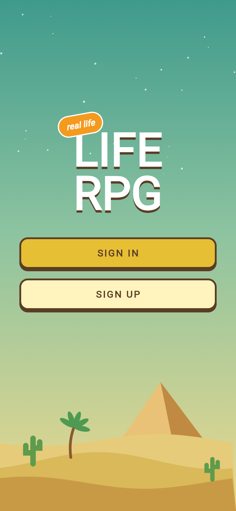
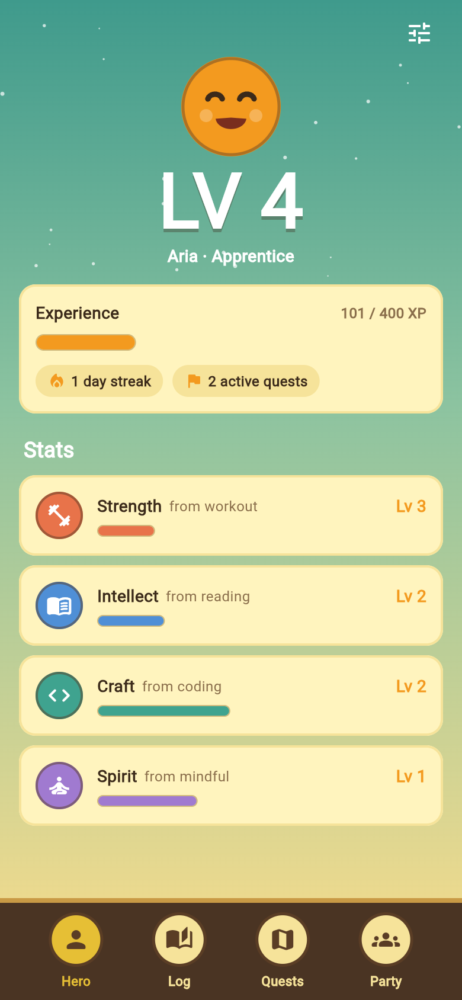
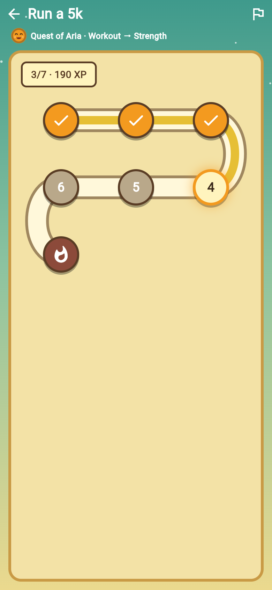
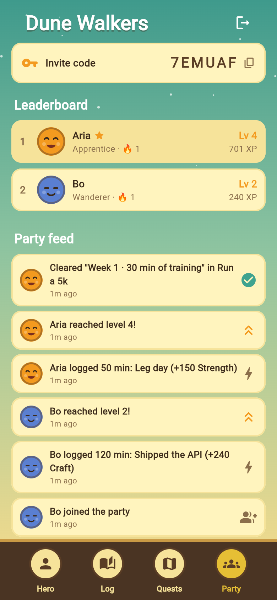

# Life RPG

A real-life game layer: your actual life as an RPG. Workouts, reading, coding and mindfulness earn XP
in matching character stats, your real goals turn into quests, and friends join as a party.

<p>
  
  
  
  
</p>

| Folder     | What                                                                 |
| ---------- | -------------------------------------------------------------------- |
| `app/`     | Flutter app (Android, iOS, web)                                      |
| `backend/` | Node.js + TypeScript API: Fastify, Prisma, PostgreSQL, JWT auth      |

## How the game works

| Real life   | Stat      | XP per minute |
| ----------- | --------- | ------------- |
| Workout     | Strength  | 3             |
| Reading     | Intellect | 2             |
| Coding      | Craft     | 2             |
| Mindfulness | Spirit    | 2             |

- **Streaks.** Logging on consecutive days adds +10% XP per day, capped at +50%. Days are UTC calendar days.
- **Limits.** Up to 240 minutes count per entry, and every entry earns at least 5 XP.
- **Levels.** Total XP to reach level *L* is `50·L·(L−1)`, so 0, 100, 300, 600, 1000 and so on.
  Each stat levels on the same curve.
- **Quests from goals.** You give a goal, a category, the number of weeks, sessions per week and minutes per session.
  That becomes one step per session plus a final **boss step**. Logging a matching activity that is long enough
  clears the next open step automatically. You mark the boss step done yourself once you've really hit the goal.
  Finishing the quest pays its reward into the quest's stat.
- **Parties.** Create a party and share the 6-character invite code. A party quest can be advanced by any member,
  and everyone in the party gets the reward. The party feed shows logs, level-ups and quest progress.

All rules live in [`backend/src/game.ts`](backend/src/game.ts) as pure functions.

## Running it

### 1. Database

```sh
docker compose up -d db        # Postgres 16 on :5432, creates `rpo` and `rpo_test`
```

### 2. API

```sh
cd backend
cp .env.example .env           # set a real JWT_SECRET outside local dev
npm install
npx prisma migrate deploy
npm run dev                    # http://localhost:8080
npm test                       # unit + API tests against rpo_test
```

### 3. App

```sh
cd app
flutter pub get
flutter run                                         # Android emulator uses http://10.0.2.2:8080
flutter run -d chrome                               # web uses http://localhost:8080
flutter run --dart-define=API_URL=http://192.168.1.20:8080   # physical device: point at your machine
flutter test
```

Android only allows cleartext `http://` in debug builds. Put the API behind HTTPS for release.

## API

All routes except `/auth/*` and `/health` need `Authorization: Bearer <token>`.

| Method | Path | |
| ------ | ---- | - |
| POST | `/auth/register` | `{email, password, displayName, avatar?}` → `{token, user}` |
| POST | `/auth/login` | `{email, password}` → `{token, user}` |
| GET / PATCH | `/me` | Character sheet: level, title, XP progress, stats, streak |
| GET | `/activities` | `?limit&before&category` |
| POST | `/activities` | `{category, title, minutes, note?}` → `{activity, xpGained, streak, levelUp, quest}` |
| DELETE | `/activities/:id` | Takes the XP back and reopens a quest step it cleared |
| GET | `/quests` | Your quests plus your party's quests, `?status` |
| POST | `/quests/preview` | Goal → plan, without saving |
| POST | `/quests/from-goal` | `{goal, category, weeks, sessionsPerWeek, minutesPerSession, forParty}` |
| POST | `/quests` | Custom quest with your own steps |
| POST | `/quests/:id/steps/:stepId/complete` | Mark a step done, e.g. the boss |
| POST | `/quests/:id/abandon` | Owner only |
| GET / POST | `/party` | Get, or create with `{name}` |
| POST | `/party/join` · `/party/leave` | Join with `{code}`. Leadership passes on when the leader leaves |
| GET | `/party/feed` | Latest party events |

## Not done yet

- No refresh tokens. JWTs last 30 days and the app stores the token in `shared_preferences`.
  Move it to secure storage before shipping.
- No rate limiting on `/auth`.
- Streaks use UTC days, not the player's own timezone.
- Activities are on the honor system: nothing verifies them yet (e.g. via Health Connect, GitHub or Goodreads).
