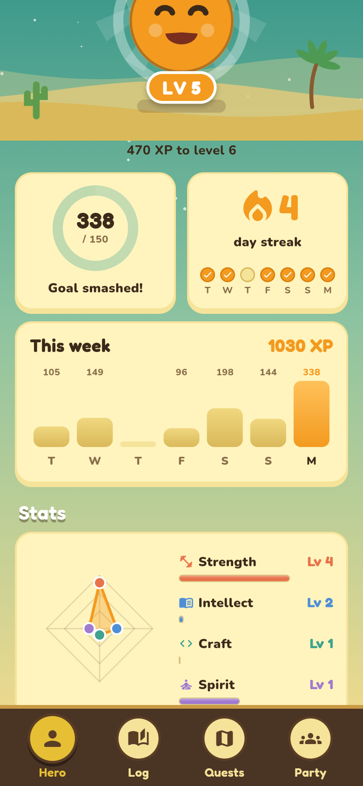
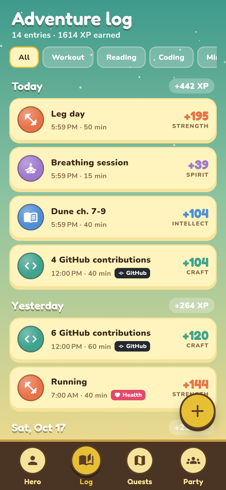
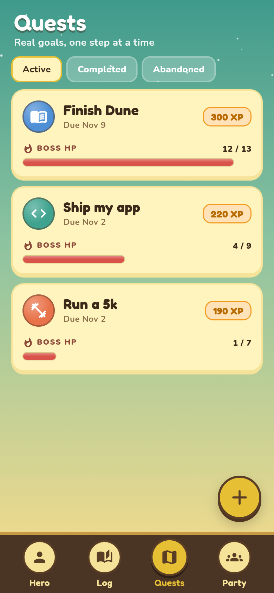
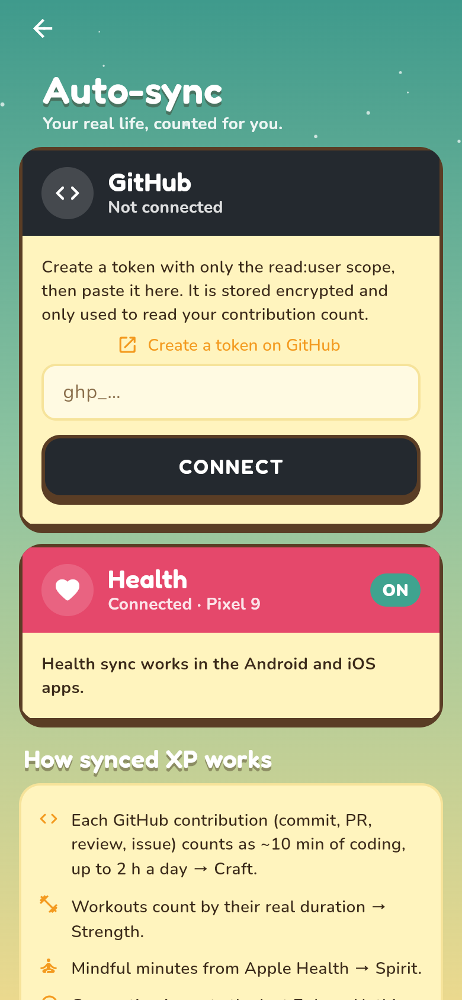
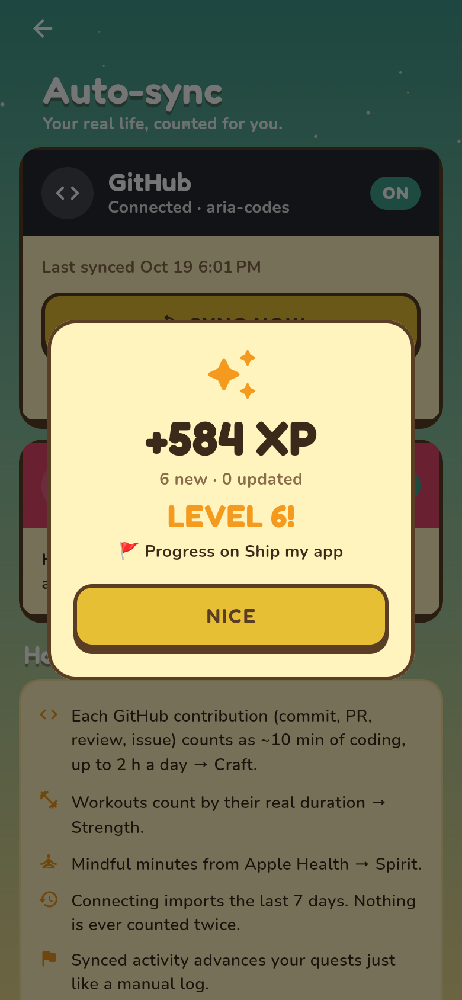

# Life RPG

A real-life game layer: your actual life as an RPG. Workouts, reading, coding and mindfulness earn XP
in matching character stats, your real goals turn into quests, and friends join as a party.

<p>
  
  
  
  
</p>
<p>
  
  
  
  
  
</p>

| Folder     | What                                                                 |
| ---------- | -------------------------------------------------------------------- |
| `app/`     | Flutter app (Android, iOS, web)                                      |
| `backend/` | Node.js + TypeScript API: Fastify, Prisma, PostgreSQL, JWT auth      |

## How the game works

| Real life   | Stat      | XP per minute |
| ----------- | --------- | ------------- |
| Workout     | Strength  | 3             |
| Reading     | Intellect | 2             |
| Coding      | Craft     | 2             |
| Mindfulness | Spirit    | 2             |

- **Streaks.** Logging on consecutive days adds +10% XP per day, capped at +50%. Days are UTC calendar days.
- **Limits.** Up to 240 minutes count per entry, and every entry earns at least 5 XP.
- **Levels.** Total XP to reach level *L* is `50·L·(L−1)`, so 0, 100, 300, 600, 1000 and so on.
  Each stat levels on the same curve.
- **Quests from goals.** You give a goal, a category, the number of weeks, sessions per week and minutes per session.
  That becomes one step per session plus a final **boss step**. Logging a matching activity that is long enough
  clears the next open step automatically. You mark the boss step done yourself once you've really hit the goal.
  Finishing the quest pays its reward into the quest's stat.
- **Parties.** Create a party and share the 6-character invite code. A party quest can be advanced by any member,
  and everyone in the party gets the reward. The party feed shows logs, level-ups and quest progress, and
  party-mates can cheer each other's moments.
- **Auto-sync.** Connect GitHub and Health Connect (Android) or Apple Health (iOS), and real activity earns XP
  without manual logging. See [Integrations](#integrations).

All rules live in [`backend/src/game.ts`](backend/src/game.ts) as pure functions.

## Integrations

### GitHub → Craft

The API reads your daily **contribution count** (commits, PRs, reviews and issues: the same number as your
profile graph) through GitHub's GraphQL API. Each contribution counts as ~10 minutes of coding, up to 2 hours
a day. Each day becomes one Coding activity keyed by date, so re-syncing never double counts. If more
contributions land later the same day, that day's activity grows.

There are two ways to connect:

- **Sign in with GitHub (recommended).** Create an OAuth app at *GitHub → Settings → Developer settings →
  OAuth Apps*, tick **Enable Device Flow**, and set `GITHUB_CLIENT_ID` in `backend/.env`. The app then shows
  a code and opens github.com/login/device. No client secret is needed.
- **Personal access token.** If `GITHUB_CLIENT_ID` isn't set, the app asks for a classic token with only the
  `read:user` scope.

Tokens are stored AES-256-GCM encrypted with `TOKEN_ENCRYPTION_KEY`.

### Health Connect / Apple Health → Strength & Spirit

Health data lives on the phone, so the app reads exercise sessions (and mindful minutes on iOS) with the
[`health`](https://pub.dev/packages/health) package and uploads them. Each session is keyed by its
platform ID, so nothing is counted twice. The app syncs on launch and whenever it returns to the foreground.

- **Android:** needs the Health Connect app (built into Android 14+). The manifest already declares
  `READ_EXERCISE`, the permissions-rationale intent and the privacy-policy activity alias, and `minSdk` is 26.
  Before publishing to Play, point the alias at a real privacy policy screen.
- **iOS:** usage strings and the HealthKit entitlement are already in place. In Xcode, make sure the Runner
  target's *Signing & Capabilities* shows **HealthKit** for your team.

On first connect both sources import the previous 7 days. Older history is ignored so connecting doesn't
dump months of XP at once. Back-dated imports never reset your streak. Synced activities can't be deleted
from the log; disconnect the source instead.

## Running it

### 1. Database

```sh
docker compose up -d db        # Postgres 16 on :5432, creates `rpo` and `rpo_test`
```

### 2. API

```sh
cd backend
cp .env.example .env           # set real JWT_SECRET / TOKEN_ENCRYPTION_KEY outside local dev
npm install
npx prisma migrate deploy
npm run dev                    # http://localhost:8080
npm test                       # unit + API tests against rpo_test
```

### 3. App

```sh
cd app
flutter pub get
flutter run                                         # Android emulator uses http://10.0.2.2:8080
flutter run -d chrome                               # web uses http://localhost:8080
flutter run --dart-define=API_URL=http://192.168.1.20:8080   # physical device: point at your machine
flutter test
```

Android only allows cleartext `http://` in debug builds. Put the API behind HTTPS for release.

## API

All routes except `/auth/*` and `/health` need `Authorization: Bearer <token>`.

| Method | Path | |
| ------ | ---- | - |
| POST | `/auth/register` | `{email, password, displayName, avatar?}` → `{token, user}` |
| POST | `/auth/login` | `{email, password}` → `{token, user}` |
| GET / PATCH | `/me` | Character sheet: level, title, XP progress, stats, streak |
| GET | `/activities` | `?limit&before&category` |
| POST | `/activities` | `{category, title, minutes, note?}` → `{activity, xpGained, streak, levelUp, quest}` |
| DELETE | `/activities/:id` | Takes the XP back and reopens a quest step it cleared |
| GET | `/quests` | Your quests plus your party's quests, `?status` |
| POST | `/quests/preview` | Goal → plan, without saving |
| POST | `/quests/from-goal` | `{goal, category, weeks, sessionsPerWeek, minutesPerSession, forParty}` |
| POST | `/quests` | Custom quest with your own steps |
| POST | `/quests/:id/steps/:stepId/complete` | Mark a step done, e.g. the boss |
| POST | `/quests/:id/abandon` | Owner only |
| GET / POST | `/party` | Get, or create with `{name}` |
| POST | `/party/join` · `/party/leave` | Join with `{code}`. Leadership passes on when the leader leaves |
| GET | `/party/feed` | Latest party events, with cheer counts |
| POST | `/party/feed/:eventId/cheer` | Toggle a cheer on a party-mate's event |
| GET | `/integrations` | GitHub and Health connection status |
| POST | `/integrations/github/token` | `{token}`: connect with a personal access token and sync |
| POST | `/integrations/github/device/start` · `/poll` | OAuth device flow (`/poll` takes `{deviceCode}`) |
| POST | `/integrations/github/sync` | Pull new contributions |
| POST | `/integrations/health/import` | `{device, sessions: [{id, kind, title, start, end}]}` from the phone |
| DELETE | `/integrations/github` · `/integrations/health` | Disconnect (earned XP stays) |

## Not done yet

- No refresh tokens. JWTs last 30 days and the app stores the token in `shared_preferences`.
  Move it to secure storage before shipping.
- No rate limiting on `/auth`.
- Streaks use UTC days, not the player's own timezone.
- Manual logs are still on the honor system. Synced GitHub and Health activity is the verified path.
- Health sync only runs while the app is open (on launch and resume), not in the background.
- On Android the `health` plugin exposes workouts but not mindfulness, so Spirit only syncs from Apple Health.
